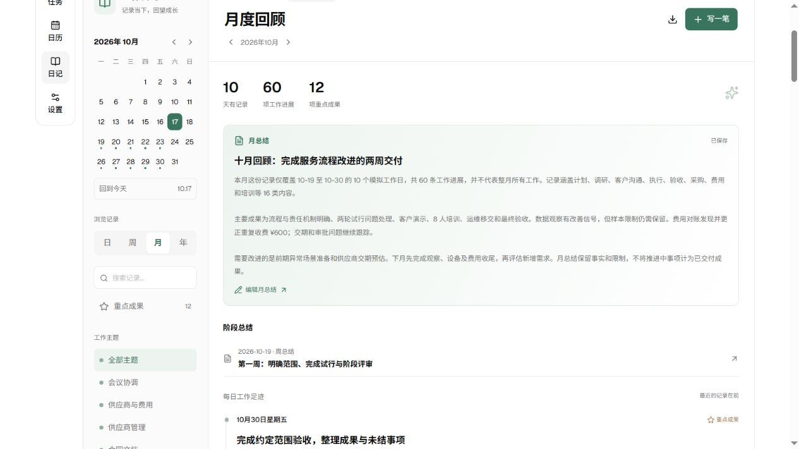

# 真实工作日记浏览器载入记录

日期：2026-10-17（Asia/Shanghai）。对象：当前 Todoa 工作区、本地 Vite、Codex In-app Browser。

入口：http://127.0.0.1:1422/work-journal-test.html

## 已载入内容

- 10 篇日记、60 条工作进展，覆盖 16 类工作。
- 4 篇独立总结：两篇周总结、一篇月总结、一篇年度总结。
- 4 个清单、40 个模拟源任务，30 个已完成、10 个未完成。
- 10 个条目重点和 2 个整篇重点，概览合计 12。

使用独立日记存储，原测试入口的 QA 日记和总结不参与这份基线。初次载入提示新增 14 篇；刷新后提示新增 0 篇。

## 浏览器实际核对

| 检查 | 实际结果 |
| --- | --- |
| 十月概览 | 10 天、60 项进展、12 项重点；显示十月总结 |
| 刷新后重新进入十月 | 仍为 10／60／12，10 篇日记；未重复写入 |
| 10-23 日记 | 6 个条目：4 个任务快照、2 个手写事项；4 个来源入口 |
| 10-23 完成素材 | 3 项，已收录按钮禁用；第 4 项为阶段进展 |
| 刷新后的来源关系 | 仍有 4 个“查看原任务”入口，来源创建身份稳定 |
| 采购管理筛选 | 2 天、12 项进展、2 项重点 |
| 仅重点筛选 | 8 天、48 项进展、12 项重点 |
| 搜索 QH-20261020-B | 1 天、6 项进展、1 项重点 |
| 已完成任务页 | 30 个具名“取消完成”控件，对应 30 个完成源任务 |

完成时间来自模拟夹具，不是点击任务完成动作的验收证据。没有通过浏览器脚本修改系统时钟。

## 代码检查

- 日记仓库及领域专项：2 个文件、9 项测试通过，包括两个日记存储互不覆盖的检查。
- TypeScript 检查通过；本次变更的 TypeScript 文件 ESLint 通过。
- Vite 生产构建通过；构建保留大于 500 kB 的分包提示。样本页面和业务样本文字未进入生产构建输出。

未执行设计中的全部 42 项用例，未进行本轮异常注入、并发、备份恢复或桌面 GUI 验收，也未打包安装程序。

## 使用与保存

开发服务器停止后，可在项目目录使用以下 PowerShell 命令重新打开：

```powershell
$env:PATH = 'C:\Users\Heart\.cache\codex-runtimes\codex-primary-runtime\dependencies\bin\fallback;' + $env:PATH
pnpm dev --host 127.0.0.1 --port 1422 --strictPort
```

然后访问上面的入口，点击“日记 → 月”。日记保存后的编辑保留，配套任务的编辑随刷新重置。普通测试入口仍使用原来的日记数据；独立入口不会覆盖它。


